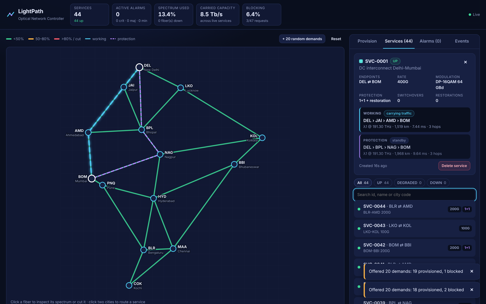

# LightPath: Optical Network Controller

LightPath is a software-defined controller for a DWDM optical transport network.
It does the core jobs of a real carrier network controller: it computes routes,
assigns wavelengths under physical constraints, protects services against fiber
cuts, restores traffic automatically, and streams alarms and optical telemetry to
a live operations dashboard.

**Live demo:** https://lightpath-syt2.onrender.com · **API docs:** https://lightpath-syt2.onrender.com/docs



---

## What it does

| Capability | How it works |
|---|---|
| **Routing & Wavelength Assignment (RWA)** | Yen's K-shortest paths (Dijkstra on fiber km) + First-Fit wavelength assignment under the *wavelength-continuity* constraint (same λ end-to-end, no converters). |
| **Optical reach / modulation** | Each line rate maps to a coherent modulation format with a maximum reach: 100G DP-QPSK (5000 km), 200G DP-QPSK 64 GBd (3500 km), 400G DP-16QAM (2000 km). Routes beyond reach are rejected. |
| **1+1 protection** | Protected services get a working path and a **link-disjoint** protection path, each with its own wavelength. |
| **Fiber-cut handling** | Cutting a fiber raises a Loss-of-Signal alarm. Protected services switch to the standby path; unprotected services are **re-routed (restoration)** if a feasible path exists, otherwise they go DOWN. |
| **1+1+R** | After a protection switch, the controller tries to rebuild a new disjoint standby path, so the service is protected again. |
| **Repair** | Repairing a fiber clears alarms and re-runs restoration for every DOWN or unprotected service. |
| **Alarms** | CRITICAL / MAJOR / MINOR alarms with raise/clear semantics, acknowledgement, history, and hysteresis on threshold alarms so they don't flap. |
| **Telemetry (PM)** | Per-fiber OSNR and Rx power sampled every 2 s. OSNR is modelled from the number of 80 km amplified spans; random impairments degrade it and trigger `OSNR_DEGRADED`. |
| **Real-time UI** | A WebSocket pushes a fresh network snapshot on every change. The UI shows the topology, per-fiber DWDM spectrum (40 × 100 GHz channels), service paths, alarms and an event log. |
| **Traffic simulation** | Offer random demands to study spectrum fill and **blocking probability**. |

The reference topology is a 14-node, 24-fiber national backbone across Indian
cities. Fiber lengths are estimated from great-circle distance × 1.25 route factor.

## Architecture

```
┌──────────────────────────── Browser ────────────────────────────┐
│ React + TypeScript (Vite)                                       │
│  TopologyMap (SVG) · LinkPanel (spectrum, PM) · Provision form  │
│  Services · Alarms · Events          ▲ WebSocket /ws (push)     │
└──────────────────────┬───────────────┼──────────────────────────┘
                       │ REST /api/*   │ snapshot on every change
┌──────────────────────▼───────────────┴──────────────────────────┐
│ FastAPI (uvicorn)                                               │
│  api.py ── schemas.py (Pydantic) ── realtime.py (SnapshotHub)   │
│  ratelimit.py · security headers · gzip · SPA static serving    │
│                         │                                       │
│  controller.py  ◄── telemetry loop (asyncio, every 2 s)         │
│   provisioning · fault handling · alarms · events · PM          │
│                         │                                       │
│  routing.py (Dijkstra, Yen, First-Fit, reach) · topology.py     │
└─────────────────────────────────────────────────────────────────┘
```

* **`topology.py`**: network graph; each fiber has a channel array (`None` or owning service id).
* **`routing.py`**: pure path-computation functions, unit-tested independently.
* **`controller.py`**: the single owner of mutable state. It has no HTTP code, takes a re-entrant lock on every public method, and its invariant is "a channel is never double-booked".
* **`realtime.py`**: fans out snapshots to WebSocket clients, dropping slow or dead clients.

## Run locally

**Prerequisites:** Python 3.10+ and Node 20+.

```bash
# backend (terminal 1)
cd backend
python -m venv .venv
# Windows: .venv\Scripts\activate    macOS/Linux: source .venv/bin/activate
pip install -r requirements-dev.txt
uvicorn app.main:app --reload --port 8000

# frontend (terminal 2)
cd frontend
npm install
npm run dev          # http://localhost:5173 (proxies /api and /ws to :8000)
```

**Production-style, single process:** `npm run build` in `frontend`, then from `backend`:

```bash
STATIC_DIR=../frontend/dist uvicorn app.main:app --port 8000   # http://localhost:8000
```

**Docker:**

```bash
docker build -t lightpath .
docker run -p 8000:8000 lightpath
```

## Tests & quality

```bash
cd backend && pytest        # 35 tests: routing, RWA, protection, restoration, API, WebSocket, rate limiting
ruff check . && ruff format --check .
cd ../frontend && npm run build   # strict TypeScript type-check + production build
```

GitHub Actions runs all of the above plus a Docker build on every push.

## Deploy (Render, free tier)

1. Push this repository to GitHub.
2. On [render.com](https://render.com), choose **New → Blueprint**, then pick the repo. `render.yaml` configures a Docker web service with a health check on `/api/health`.
3. Open the URL Render gives you. The free tier sleeps when idle, so the first load can take about 30 s.

## REST API

| Method | Path | Purpose |
|---|---|---|
| GET | `/api/health` | Liveness and current state version |
| GET | `/api/snapshot` | Full state: topology, spectrum, services, alarms, events, KPIs |
| POST | `/api/services` | Provision `{src, dst, rate_gbps, protection, name?}`. Returns **409 + reason** if blocked |
| GET/DELETE | `/api/services/{id}` | Inspect or decommission a service |
| POST | `/api/paths/compute` | What-if: K candidate routes with reach and wavelength feasibility |
| POST | `/api/links/{id}/fail` · `/repair` | Fiber cut / repair; returns affected, switched, restored and down services |
| GET | `/api/links/{id}/telemetry` | OSNR / Rx-power history |
| POST | `/api/alarms/{id}/ack` | Acknowledge an alarm |
| POST | `/api/simulate/traffic` | Offer N random demands |
| POST | `/api/reset` | Restore the reference network |
| WS | `/ws` | Push stream of `{"type":"snapshot","data":…}` |

## Design decisions & trade-offs

* **In-memory state, single worker.** This keeps the demo fast and simple. For production HA, state would move to a database or an event-sourced store, with a leader-elected controller.
* **Snapshot push instead of deltas.** The demo state is about 2.5 KB gzipped (around 14 KB at 220 services), so pushing full snapshots is simpler and self-healing (no missed-delta bugs). Deltas would be the next step at scale.
* **First-Fit wavelength assignment.** It's simple, fast and has known low blocking. Most-Used or spectrum-defragmentation strategies are natural extensions.
* **Restoration chooses the shortest feasible path at the time of failure.** Production systems add pre-computed restoration paths and SRLG (shared-risk link group) diversity.
* **Rate limiting is in-process.** That's fine for one instance; with multiple instances it belongs in the gateway or Redis.

## Possible extensions

Flexible-grid / elastic optical networking (spectrum slots instead of fixed λ),
SRLG-aware diversity, OSNR-based path feasibility instead of a fixed reach table,
persistent storage, authentication / RBAC, and Prometheus metrics.

## License

MIT
